



&nbsp;&nbsp;


<a href="https://github.com/Tiaguitoo09?tab=repositories"></a><a href="https://github.com/Tiaguitoo09?tab=repositories"></a>

<a href="https://github.com/Tiaguitoo09/Equilibrio"></a><a href="https://github.com/Tiaguitoo09?tab=repositories"></a>

<a href="https://github.com/Tiaguitoo09?tab=repositories"></a><a href="https://github.com/Tiaguitoo09?tab=repositories"></a>




<picture>
  <source media="(prefers-color-scheme: dark)" srcset="https://raw.githubusercontent.com/Tiaguitoo09/Tiaguitoo09/output/github-snake-dark.svg">
  
</picture>

<a href="https://www.linkedin.com/in/santiago-martinez-beltran-a90243263">LinkedIn</a> · <a href="mailto:martinezbeltransantiago9@gmail.com">martinezbeltransantiago9@gmail.com</a> · Bogotá, Colombia

